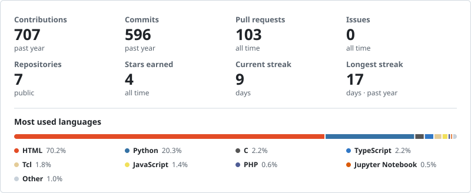

<p align="center">
  
</p>

<p align="center">
  <a href="https://www.linkedin.com/in/manula-chandupa-4049862ba" target="_blank">
    
  </a>
  <a href="mailto:iit22011@std.uwu.ac.lk">
    
  </a>
  
  
  
</p>

---

### 👨‍💻 About Me

```console
┌──(chandhim㉿github)-[~]
└─$ whoami --verbose

  Name ........ Manula Chandupa
  Degree ...... B.Sc. in Information Technology (Undergraduate)
  University .. Uva Wellassa University of Sri Lanka 🇱🇰
  Focus ....... Full-Stack Web Development, System Architecture & Applied ML
  Passions .... Building practical products, clean code & responsive UI/UX
```

- 🎓 **Information Technology Undergraduate** at **Uva Wellassa University of Sri Lanka**
- 🔭 Experienced in building full-stack web applications, RESTful APIs, and responsive frontends
- 💡 Passionate about **clean architecture**, **database design**, and **modern cloud technologies**
- 🤝 Open to **internship opportunities**, **collaborative projects**, and **open-source contributions**
- 📫 Reach me directly via **[LinkedIn](https://www.linkedin.com/in/manula-chandupa-4049862ba)** or **[Email](mailto:iit22011@std.uwu.ac.lk)**

---

### 🛠️ Featured Projects

| Project | Description | Tech Stack | Links |
| :--- | :--- | :--- | :---: |
| 🛋️ **[LIMATA](https://github.com/chandhim/LIMATA-One-Click-Furniture-Store)** | AI-assisted furniture e-commerce platform with 3D/AR visualization, YOLOv8 object detection, and MiDaS depth estimation. | `Python` `TypeScript` `YOLOv8` `3D/AR` | [Repository](https://github.com/chandhim/LIMATA-One-Click-Furniture-Store) |
| 🎓 **[UniWiz](https://github.com/chandhim/UniWiz_Parttime)** | Dedicated university part-time job portal connecting university students with campus and flexible local jobs. | `PHP` `JavaScript` `PostgreSQL` `Docker` | [Repository](https://github.com/chandhim/UniWiz_Parttime) |
| 🛡️ **[FraudX](https://github.com/chandhim/FraudX)** | Credit card fraud detection system utilizing machine learning classifiers trained on transaction behaviors. | `Python` `Scikit-Learn` `Jupyter` | [Repository](https://github.com/chandhim/FraudX) |
| ⏱️ **[SprintPulse](https://github.com/chandhim/sprintpulse)** | Privacy-first Chrome extension turning Jira Cloud & Trello sprints into one-click executive RAG status reports. | `JavaScript` `Chrome Extensions` `CSS` | [Repository](https://github.com/chandhim/sprintpulse) |
| 🛒 **[POS System](https://github.com/chandhim/POS)** | Retail Point of Sale software engineered for quick billing, stock control, and comprehensive checkout flows. | `TypeScript` `Node.js` `PostgreSQL` | [Repository](https://github.com/chandhim/POS) |

---

### 🧰 Tech Stack

<!--STACK:START-->
<picture><source media="(prefers-color-scheme: dark)" srcset="https://skillicons.dev/icons?i=html%2Cpy%2Cc%2Cts%2Cjs%2Cphp%2Ccss%2Ccpp%2Cjava%2Cbash%2Cswift%2Cpowershell%2Cdart%2Cruby&amp;theme=dark" /></picture><br/>
<picture><source media="(prefers-color-scheme: dark)" srcset="https://skillicons.dev/icons?i=kotlin%2Cdocker%2Cgithubactions%2Cnodejs%2Creact%2Candroidstudio%2Cexpress%2Cgradle%2Cprisma%2Celectron%2Cfastapi%2Cflutter%2Cnextjs%2Cpostgres&amp;theme=dark" /></picture><br/>
<picture><source media="(prefers-color-scheme: dark)" srcset="https://skillicons.dev/icons?i=pytorch%2Csklearn%2Csqlite%2Ctailwind%2Cthreejs%2Cvercel%2Cvite%2Cgit%2Cgithub%2Cvscode%2Cfigma%2Clinux%2Cpostman&amp;theme=dark" /></picture>
<!--STACK:END-->

<sub><i>⚡ Automatically detected from languages, frameworks, and configuration across my repositories.</i></sub>

---

### 📊 GitHub Stats

<picture>
  <source media="(prefers-color-scheme: dark)" srcset="./assets/stats-dark.svg" />
  
</picture>

---

### 🔭 Recent Activity

<!--ACTIVITY:START-->
- ⬆️ Pushed to [chandhim/chandhim](https://github.com/chandhim/chandhim) <sub>· Nov 18</sub>
- 🔀 Merged PR [#2](https://github.com/chandhim/chandhim/pull/2) in [chandhim/chandhim](https://github.com/chandhim/chandhim) <sub>· Nov 18</sub>
- 🔃 Opened PR [#2](https://github.com/chandhim/chandhim/pull/2) in [chandhim/chandhim](https://github.com/chandhim/chandhim) <sub>· Nov 18</sub>
- ⬆️ Pushed to [chandhim/chandhim](https://github.com/chandhim/chandhim) <sub>· Nov 17</sub>
- 🔀 Merged PR [#2](https://github.com/chandhim/UniWiz_Parttime/pull/2) in [chandhim/UniWiz_Parttime](https://github.com/chandhim/UniWiz_Parttime) <sub>· Nov 18</sub>
- 🔃 Opened PR [#2](https://github.com/chandhim/UniWiz_Parttime/pull/2) in [chandhim/UniWiz_Parttime](https://github.com/chandhim/UniWiz_Parttime) <sub>· Nov 18</sub>
<!--ACTIVITY:END-->

<br/>

### 🐍 Contribution Activity

<picture>
  <source media="(prefers-color-scheme: dark)" srcset="https://raw.githubusercontent.com/chandhim/chandhim/output/snake-dark.svg" />
  
</picture>

---

<p align="center">
  <b>Let's build something great together!</b><br/>
  Feel free to reach out for collaborations, project opportunities, or a quick tech discussion.
</p>

<p align="center">
  <a href="https://www.linkedin.com/in/manula-chandupa-4049862ba" target="_blank">
    
  </a>
  &nbsp;
  <a href="mailto:iit22011@std.uwu.ac.lk">
    
  </a>
  &nbsp;
  <a href="https://github.com/chandhim">
    
  </a>
</p>
